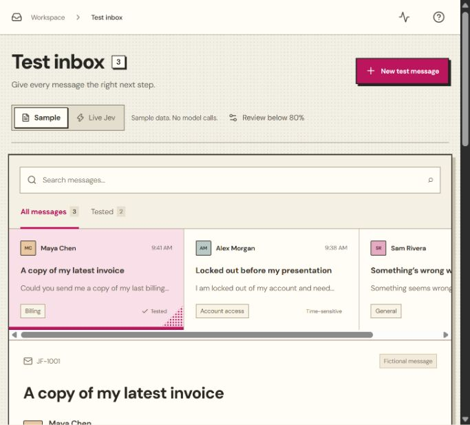

# Jev Flow

A support-triage inbox for experimenting with typed AI decisions. Choose a fictional message, evaluate its team and urgency, and inspect the application rule that routes it to human review, a priority queue, or a standard queue.

All destinations are simulated. Sample mode works without credentials or model requests.



## Highlights

- **Typed model output, deterministic policy.** The model only answers two constrained choice questions; a pure, unit-tested function decides the route. Changing the threshold reroutes instantly without another model call.
- **Human-in-the-loop by default.** Missing or low-confidence answers go to human review instead of being guessed.
- **Defensive provider boundary.** Zod validation on both request and response, a streamed body-size limit, a fixed free model, a 20-second timeout, no silent retries or paid fallbacks, and a server-side guard that keeps live calls off unless explicitly enabled.
- **Prompt-injection aware.** The message is passed as data, and each question instructs the model to treat it as data rather than instructions.
- **Inspectable decisions.** A React Flow trace and the raw request/response data show exactly which rule fired.

## Start locally

Requirements: Node.js 22.18+ and npm. The project was verified with Node.js 24.11.1.

```powershell
cd web
npm ci
npm run dev -- --hostname 127.0.0.1
```

Open [the local inbox](http://127.0.0.1:3000).

1. Select Sam's ambiguous message and click **Run decision** in Sample mode.
2. At the default 80% threshold, its illustrative probabilities send it to Human review.
3. Lower the threshold to 65%; it moves to Standard queue without a new evaluation.
4. Open Decision trace or Request data to inspect the result and routing rule.

The inbox also supports message search, a tested-message filter, a routing-rules dialog, and a ten-run in-memory history. Refreshing clears history. Input edits make an existing result stale.

## Optional live Jev access

OpenCode documented `jev-1.13-free` as a limited-time free model when checked on **25 October 2026**. Availability and account allowances are controlled by the provider; the listing does not guarantee a successful request.

1. Sign in to [OpenCode Console](https://opencode.ai/console/).
2. Create a dedicated key under Settings → Service accounts. Grant only the model-request permissions needed.
3. Copy `web/.env.example` to `web/.env.local` if it does not already exist.
4. Enter the key locally:

```dotenv
OPENCODE_API_KEY=your_key
ENABLE_LIVE_JEV=true
```

5. Restart the local server and choose Live Jev. Use fictional messages.

The server always requests `jev-1.13-free` at the fixed OpenCode System One endpoint. It does not retry automatically, choose a paid model, or silently substitute sample data. Do not buy credits or subscribe to a paid plan for this experiment.

**Observed live-test status:** a real browser request and a later diagnostic request returned HTTP 429. The diagnostic response reported `Free usage limit reached` with `Retry-After: 7524` seconds. Successful live inference remains unverified. Mocked integration tests verify the expected contract and failure handling, not the model's accuracy.

Official references:

- [OpenCode models and free access](https://opencode.ai/v2/docs/console/models/)
- [OpenCode API keys and permissions](https://opencode.ai/v2/docs/console/api/)
- [TypeSafe System One API](https://docs.typesafe.ai/api/system-one)

## Architecture

```text
Sample: Browser → bundled fixture → routing policy → simulated destination
Live:   Browser → Next.js /api/evaluate → OpenCode → Jev
                                           ↓
        Browser ← validated choices and probabilities ← provider response
           ↓
        routing policy → simulated destination
```

One live request asks two choice questions against the same message. The adapter converts the selected option's probability from 0–1 into a displayed percentage. Missing probability remains missing. The field called confidence in the UI refers to this selected-answer probability, not a combined score or a guarantee.

Routing rules run in order:

1. Missing probability → Human review.
2. Either probability below the threshold → Human review.
3. Both pass and urgency is Urgent → Priority queue.
4. Both pass and urgency is Normal → Standard queue.

Equality passes. Threshold changes recalculate the route locally. The trace animates application behavior; it does not expose model reasoning or represent sequential model calls.

| Location | Responsibility |
| --- | --- |
| `web/src/app/page.tsx` | Interactive inbox, editor, tabs, dialogs, history and submission state |
| `web/src/components/workflow-canvas.tsx` | Branching React Flow trace and replay |
| `web/src/lib/types.ts` | Application types and allowed categories |
| `web/src/lib/fixtures.ts` | Deterministic fictional samples |
| `web/src/lib/routing.ts` | Pure routing policy |
| `web/src/lib/validation.ts` | Zod schemas and typed question blueprint |
| `web/src/lib/jev.server.ts` | Fixed free-model adapter, timeout and provider-error handling |
| `web/src/app/api/evaluate/route.ts` | Server guard, streamed input limit, validation and error responses |
| `web/src/app/globals.css` | Interface layout and responsive behavior |
| `web/src/app/halftone.css` | Paper, ink and deep-pink halftone theme |

Native fetch handles the provider request; no AI SDK or database is required. Fonts are bundled locally. The initial Vercel-based proposal is preserved under [docs/archive](docs/archive/original-specification.md); this README describes the implemented app.

## Checks

Run from `web/`:

```powershell
npm run format:check
npm run lint
npm run test
npm run build
```

For a local production preview, stop the development server and run:

```powershell
npm run start -- --hostname 127.0.0.1
```

The suite has 19 cases covering routing branches, threshold equality, local rerouting, invalid JSON and input, streamed body limits, disabled live calls, fixed-model selection, probability normalization, missing probabilities, and sanitized provider failures. Browser checks covered sample routing, search, history, trace tabs, and the narrow layout.

Verified stack: Next.js 16.4.3, React 19.2.8, Zod 4.6.7, React Flow 12.12.0, Lucide 1.61.0 and Vitest 4.1.12. The npm lockfile records exact installed versions. `npm run format` applies the project's formatting rules.

## Boundaries and limitations

- Live requests require both `ENABLE_LIVE_JEV=true` and an explicit server-side key. The guard defaults to disabled.
- Input limits: a 4,000-character message, four 300-character category descriptions, and a 24,000-byte body limit enforced while reading the stream.
- The provider fetch has a 20-second abort signal. This is not a complete end-to-end request deadline.
- Keys stay server-side and local environment files are ignored. Application code does not log message contents; providers have their own data policies.
- Live input is sent to OpenCode and TypeSafe. Sample probabilities are illustrative and sample latency is unavailable.
- No authentication, durable history, application rate limiter, durable spending cap, accuracy benchmark, or real helpdesk integration is implemented.
- The displayed request duration includes the provider round trip and response processing; it excludes the animation.
- The halftone layout supports narrow screens, visible focus and reduced motion. Formal accessibility certification has not been performed.

## Optional public sample demo

No deployment has been created. A personal Vercel Hobby deployment can use root directory `web`, `ENABLE_LIVE_JEV=false`, and no provider key. The server guard also rejects direct live-endpoint requests. Local development is sufficient for the complete sample experiment.
